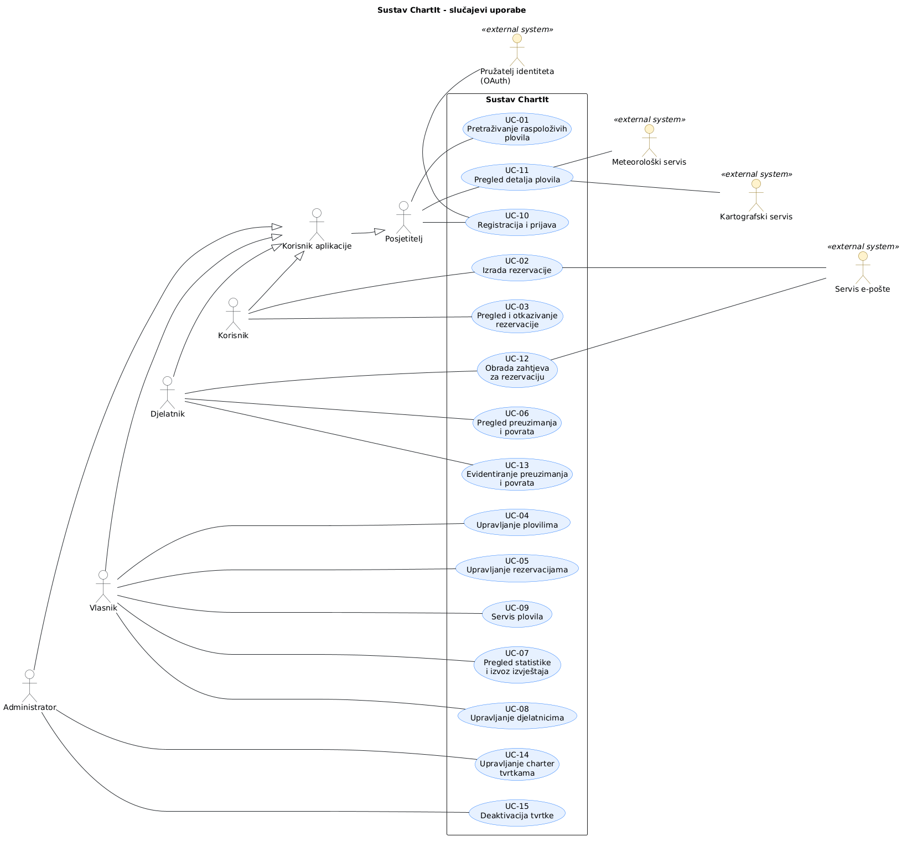

# 3. Obrasci uporabe

## 3.1 Dijagram obrazaca uporabe

*Slika 3.1. Dijagram obrazaca uporabe sustava ChartIt*

PlantUML izvor: [dijagram-obrazaca-uporabe.puml](slike/dijagram-obrazaca-uporabe.puml)

## 3.2 Specifikacije obrazaca uporabe

### UC-01: Pretraživanje raspoloživih plovila

| Element specifikacije | Opis |
|---|---|
| Primarni akter | Posjetitelj, prijavljeni Korisnik |
| Povezani zahtjevi | F-01, F-23, F-29 |
| Preduvjeti | Nema (dostupno i neprijavljenom posjetitelju). |
| Glavni uspješni tok | 1. Korisnik otvara stranicu za pretraživanje plovila. 2. Unosi željene specifikacije za termin i plovilo. 3. Sustav provjerava kriterije i raspoloživost plovila. 4. Sustav prikazuje plovila koja odgovaraju kriterijima, njihove karakteristike i cijene. 5. Korisnik odabire plovilo i otvara njegove detalje. |
| Alternativni tokovi / Iznimke | 4a: Nema raspoloživih plovila: sustav prikazuje odgovarajuću poruku i omogućuje promjenu kriterija. |
| Posljedice (ishod) | Korisnik vidi popis plovila i može otvoriti detalje ako je prijavljen. |

### UC-02: Izrada rezervacije

| Element specifikacije | Opis |
|---|---|
| Primarni akter | Korisnik |
| Povezani zahtjevi | F-02, F-03, F-04, F-06, F-11, F-20 |
| Preduvjeti | Korisnik je prijavljen, odabrao je plovilo i plovilo je dostupno u traženom terminu. |
| Glavni uspješni tok | 1. Korisnik odabire plovilo i razdoblje najma. 2. Sustav ponovno provjerava dostupnost plovila. 3. Korisnik odabire dodatne usluge. 4. Sustav izračunava ukupnu cijenu najma i dodatnih usluga. 5. Korisnik pregledava podatke i šalje zahtjev za rezervaciju. 6. Djelatnik odobri rezervaciju te se korisniku šalje potvrda putem e-pošte. |
| Alternativni tokovi / Iznimke | 2a: Plovilo nije dostupno: sustav ne dopušta rezervaciju i traži novi termin. 5a: Termin je u međuvremenu zauzet: sustav odbija slanje i traži novi termin. |
| Posljedice (ishod) | Rezervacija je potvrđena, termin plovila je zauzet, a korisnik je obaviješten e-poštom. |

### UC-03: Pregled i otkazivanje rezervacije

| Element specifikacije | Opis |
|---|---|
| Primarni akter | Korisnik |
| Povezani zahtjevi | F-04, F-05, F-19, F-21, F-24 |
| Preduvjeti | Korisnik je prijavljen i ima barem jednu aktivnu rezervaciju. |
| Glavni uspješni tok | 1. Korisnik otvara stranicu za pregled rezervacija. 2. Sustav prikazuje korisnikove rezervacije i njihove statuse. 3. Korisnik odabire rezervaciju koju želi pregledati. 4. Sustav prikazuje detalje rezervacije i ukupni iznos. 5. Korisnik odabire opciju otkazivanja i prihvaća no refund. 6. Sustav mijenja status rezervacije u "otkazana", oslobađa termin i šalje e-poštu korisniku. |
| Alternativni tokovi / Iznimke | 4a: Rezervacija se ne može otkazati: njezin status nije "zahtjev" ni "potvrđena" (npr. najam je završen). Sustav ne nudi otkazivanje i prikazuje poruku. 5a: Korisnik odustaje: sustav prikaže upozorenje o no refund, korisnik ga pročita i odustane. Status rezervacije ostaje nepromijenjen. |
| Posljedice (ishod) | Rezervacija ima status "otkazana", termin plovila je automatski slobodan, korisnik je obaviješten e-poštom. |

### UC-04: Upravljanje plovilima i njihovim karakteristikama

| Element specifikacije | Opis |
|---|---|
| Primarni akter | Vlasnik |
| Povezani zahtjevi | F-07 |
| Preduvjeti | Vlasnik je prijavljen i ima pristup svojoj tvrtki pa upravlja samo plovilima svoje tvrtke. |
| Glavni uspješni tok | 1. Vlasnik otvara admin panel. 2. Vlasnik odabire opciju za dodavanje, izmjenu ili brisanje plovila. 3. Vlasnik popunjava ili mijenja karakteristike, fotografije, opremu, cijene i dodatne usluge vezane za plovilo. 4. Vlasnik sprema promjene. 5. Sustav sprema podatke i prikazuje ažurirani popis plovila. |
| Alternativni tokovi / Iznimke | 4a: Uneseni podaci nisu ispravni (npr. neispunjeno obavezno polje ili sl.): sustav ne sprema promjene, prikazuje grešku i traži ponovni unos podataka. |
| Posljedice (ishod) | Podaci o plovilu su ažurirani. |

### UC-05: Upravljanje rezervacijama

| Element specifikacije | Opis |
|---|---|
| Primarni akter | Vlasnik |
| Povezani zahtjevi | F-04, F-08, F-19 |
| Preduvjeti | Vlasnik je prijavljen i ima pristup svojoj tvrtki pa upravlja samo rezervacijama za plovila svoje tvrtke. |
| Glavni uspješni tok | 1. Vlasnik otvara admin panel. 2. Vlasnik otvara pregled svih rezervacija. 3. Vlasnik odabire rezervaciju i pregledava njezine podatke i status. 4. Vlasnik dodaje novu rezervaciju ili mijenja ili otkazuje postojeću rezervaciju. 5. Sustav sprema promjene i ažurira prikaz rezervacija. |
| Alternativni tokovi / Iznimke | 5a: Rezervacija se preklapa s postojećom rezervacijom: sustav ne dopušta spremanje promjene i prikazuje odgovarajuću poruku. |
| Posljedice (ishod) | Podaci o rezervacijama su ažurirani. |

### UC-06: Pregled preuzimanja i povrata plovila

| Element specifikacije | Opis |
|---|---|
| Primarni akter | Djelatnik |
| Povezani zahtjevi | F-12 |
| Preduvjeti | Djelatnik je prijavljen i vidi samo podatke svoje tvrtke. |
| Glavni uspješni tok | 1. Djelatnik otvara admin panel. 2. Djelatnik otvara raspored preuzimanja i povrata plovila. 3. Sustav prikazuje rezervacije prema terminima preuzimanja i povrata. 4. Djelatnik odabire rezervaciju i pregledava podatke o plovilu i korisniku. |
| Alternativni tokovi / Iznimke | 3a: Nema rezervacija za odabrano razdoblje, sustav prikazuje odgovarajuću poruku. |
| Posljedice (ishod) | Nema. |

### UC-07: Pregled statistike i izvoz izvještaja

| Element specifikacije | Opis |
|---|---|
| Primarni akter | Vlasnik |
| Povezani zahtjevi | F-13, F-14 |
| Preduvjeti | Vlasnik je prijavljen i dodijeljen svojoj tvrtki. |
| Glavni uspješni tok | 1. Vlasnik otvara admin panel. 2. Vlasnik otvara pregled statistike i izvještaja. 3. Vlasnik odabire razdoblje za koje želi pregledati podatke. 4. Sustav prikazuje statistiku zauzetosti plovila, broj rezervacija, ostvareni prihod i popularnost usluga. 5. Vlasnik odabire opciju izvoza izvještaja. 6. Sustav izvozi izvještaj u odabranom formatu. |
| Alternativni tokovi / Iznimke | 4a: Nema podataka za odabrano razdoblje: sustav prikazuje odgovarajuću poruku. |
| Posljedice (ishod) | Izvještaj je dostupan kao datoteka. |

### UC-08: Upravljanje djelatnicima tvrtke

| Element specifikacije | Opis |
|---|---|
| Primarni akter | Vlasnik |
| Povezani zahtjevi | F-27 |
| Preduvjeti | Vlasnik je prijavljen i dodijeljen je svojoj tvrtki. |
| Glavni uspješni tok | 1. Vlasnik otvara admin panel. 2. Vlasnik otvara pregled svih djelatnika. 3. Vlasnik dodaje novog djelatnika. 4. Sustav sprema promjene. |
| Alternativni tokovi / Iznimke | 4a: Uneseni podaci o djelatniku nisu ispravni (npr. e-mail već postoji, obavezno polje nije ispunjeno): sustav ne sprema promjene, prikazuje poruku i traži ponovni unos podataka. |
| Posljedice (ishod) | Novi djelatnik je dodan u tvrtku. |

### UC-09: Servis plovila

| Element specifikacije | Opis |
|---|---|
| Primarni akter | Vlasnik |
| Povezani zahtjevi | F-08, F-09 |
| Preduvjeti | Vlasnik je prijavljen i dodijeljen je svojoj tvrtki, postoji barem jedno plovilo u sustavu. |
| Glavni uspješni tok | 1. Vlasnik otvara admin panel. 2. Vlasnik otvara pregled plovila. 3. Vlasnik odabire plovilo i otvara detalje plovila. 4. Vlasnik bira termin tijekom kojeg plovilo neće biti raspoloživo i razlog. 5. Sustav sprema promjene i ažurira raspoloživost rezervacija. |
| Alternativni tokovi / Iznimke | 5a: Odabrani termin preklapa se s postojećom rezervacijom: sustav prikazuje upozorenje i traži od vlasnika odabir drugog termina. |
| Posljedice (ishod) | Termin je nedostupan za rezervaciju u razdoblju servisa. |

### UC-10: Registracija i prijava

| Element specifikacije | Opis |
|---|---|
| Primarni akter | Korisnik |
| Povezani zahtjevi | F-17, F-18 |
| Preduvjeti | Korisnik nije većprijavljen, vanjski OAuth usluga dostupna. |
| Glavni uspješni tok | 1. Korisnik odabire prijavu. 2. Sustav preusmjerava korisnika na OAuth pružatelja. 3. Korisnik potvrđuje pristup. 4. Sustav stvara račun (ako ne postoji) s ulogom korisnika i prijavljuje ga. |
| Alternativni tokovi / Iznimke | 3a: Prijava kod pružatelja ne uspije ili korisnik odbije pristup: sustav prikazuje poruku i korisnik ostaje neprijavljen. |
| Posljedice (ishod) | Korisnik prijavljen, a ako račun nije postojao, kreiran je s ulogom korisnika. |

### UC-11: Pregled detalja plovila

| Element specifikacije | Opis |
|---|---|
| Primarni akter | Korisnik |
| Povezani zahtjevi | F-15, F-16, F-20 |
| Preduvjeti | Plovilo postoji u sustavu. |
| Glavni uspješni tok | 1. Korisnik otvara plovilo. 2. Sustav prikazuje karakteristike, fotografije, cijenu, slobodne termine, kartu matične luke i vremensku prognozu za odabrani termin. |
| Alternativni tokovi / Iznimke | 2a: Meteorološki ili kartografski servis nije dostupan: sustav prikazuje obavijest o nedostupnosti tog servisa i prikazuje ostale podatke (NF-06). 2b: Nema slobodnih termina za plovilo: sustav prikazuje poruku i ostale podatke o plovilu. |
| Posljedice (ishod) | Prikaz podataka. |

### UC-12: Obrada zahtjeva za rezervaciju

| Element specifikacije | Opis |
|---|---|
| Primarni akter | Djelatnik |
| Povezani zahtjevi | F-03, F-04, F-06, F-11, F-24 |
| Preduvjeti | Djelatnik je prijavljen i dodijeljen je charter tvrtki; postoji barem jedan zahtjev za rezervaciju plovila njegove tvrtke sa statusom "zahtjev". |
| Glavni uspješni tok | 1. Djelatnik otvara popis zahtjeva. 2. Pregledava zahtjev. 3. Potvrđuje ga ili odbija. 4. Sustav mijenja status i šalje e-poštu korisniku. |
| Alternativni tokovi / Iznimke | 3a: Plovilo je u međuvremenu zauzeto: sustav ne dopušta potvrdu, automatski odbija zahtjev i šalje e-poštu korisniku. |
| Posljedice (ishod) | U slučaju potvrde rezervacije: termin plovila je zauzet. Kod odbijanja rezervacije: termin ostaje slobodan. U oba slučaja korisnik je obaviješten e-mailom. |

### UC-13: Evidentiranje preuzimanja i povrata

| Element specifikacije | Opis |
|---|---|
| Primarni akter | Djelatnik |
| Povezani zahtjevi | F-12, F-22 |
| Preduvjeti | Djelatnik je prijavljen i dodijeljen je svojoj tvrtki, postoji potvrđena rezervacija plllovila spremnog za preuzimanje ili povrat. |
| Glavni uspješni tok | 1. Djelatnik odabire rezervaciju iz rasporeda. 2. Pregledava zahtjev. 3. Evidentira preuzimanje, a pri povratu označava najam završenim. |
| Alternativni tokovi / Iznimke | Nema. |
| Posljedice (ishod) | Preuzimanje je evidentirano. Rezervacija ima status "završeni najam", plovilo ponovno dostupno. |

### UC-14: Upravljanje charter tvrtkama

| Element specifikacije | Opis |
|---|---|
| Primarni akter | Administrator |
| Povezani zahtjevi | F-25, F-26 |
| Preduvjeti | Administrator je prijavljen i ima administratorske ovlasti. |
| Glavni uspješni tok | 1. Administrator otvara popis tvrtki. 2. Dodaje novu tvrtku i unosi njezine podatke. 3. Dodjeljuje vlasnika (postojećeg korisnika ili novi račun). 4. Sustav sprema tvrtku i vlasniku omogućuje pristup. |
| Alternativni tokovi / Iznimke | 4a: Tvrtka s istim OIB-om već postoji: sustav ne sprema tvrtku, prikazuje poruku i traži ponovni unos podataka. |
| Posljedice (ishod) | Tvrtka je dodana u sustav, a dodijeljeni vlasnik ima pristup upravljanju svojom tvrtkom. |

### UC-15: Deaktivacija tvrtke

| Element specifikacije | Opis |
|---|---|
| Primarni akter | Administrator |
| Povezani zahtjevi | F-25 |
| Preduvjeti | Administrator je prijavljen i ima administratorske ovlasti, u sustavu postoji aktivna tvrtka. |
| Glavni uspješni tok | 1. Administrator odabire tvrtku i deaktivira je. 2. Sustav uklanja njezina plovila iz pretraživanja i zadržava postojeće podatke. |
| Alternativni tokovi / Iznimke | 1a: Tvrtka ima aktivne potvrđene rezervacije: sustav prikazuje upozorenje i traži potvrdu. |
| Posljedice (ishod) | Tvrtka je deaktivirana: njezina plovila se više ne prikazuju u pretraživanju, a postojeći podaci su zadržani. |

## 3.3 Provjera dosljednosti obrazaca uporabe

| Provjera | Odgovor |
|---|---|
| Zahtjev: je li svaki važan obrazac uporabe povezan s postojećim zahtjevom? | Da. Svaki UC (UC-01 do UC-15) navodi povezane funkcijske zahtjeve. |
| Akter: odgovara li akter prethodno utvrđenoj ulozi i dopuštenoj interakciji? | Da. Primarni akteri (Posjetitelj, Korisnik, Djelatnik, Vlasnik i Administrator) odgovaraju ulogama iz poglavlja 2. |
| Aplikacija: može li tim demonstrirati glavni rezultat i važnu alternativu? | Za sada je to samo plan(oblikovanje), a pokazat ćemo ga kad aplikacija bude gotova.. |