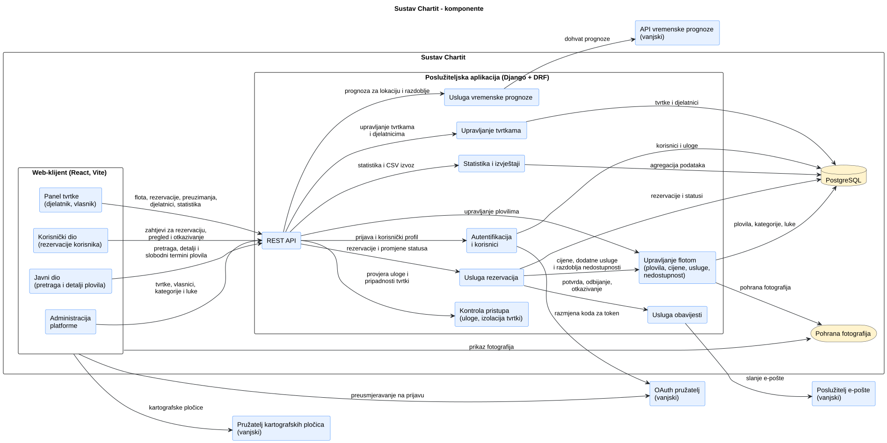
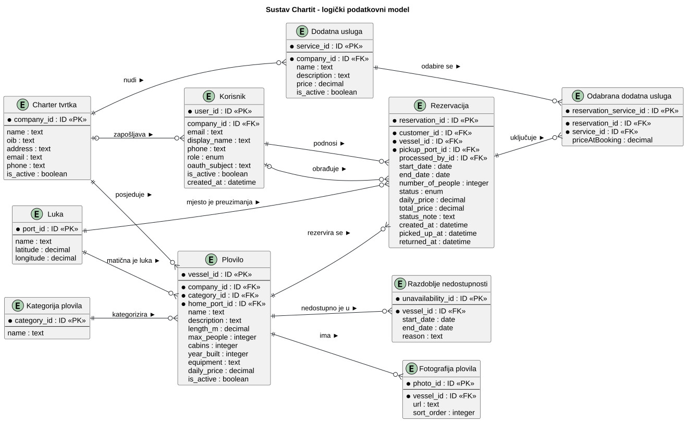
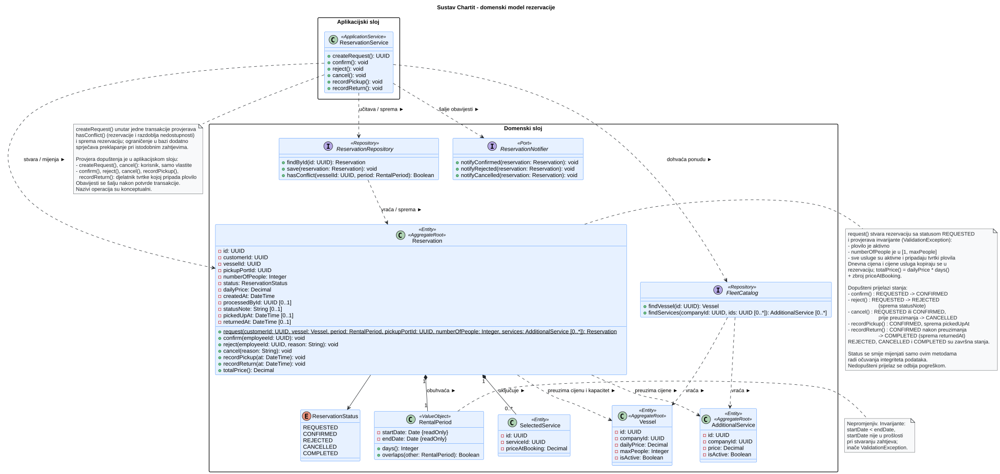
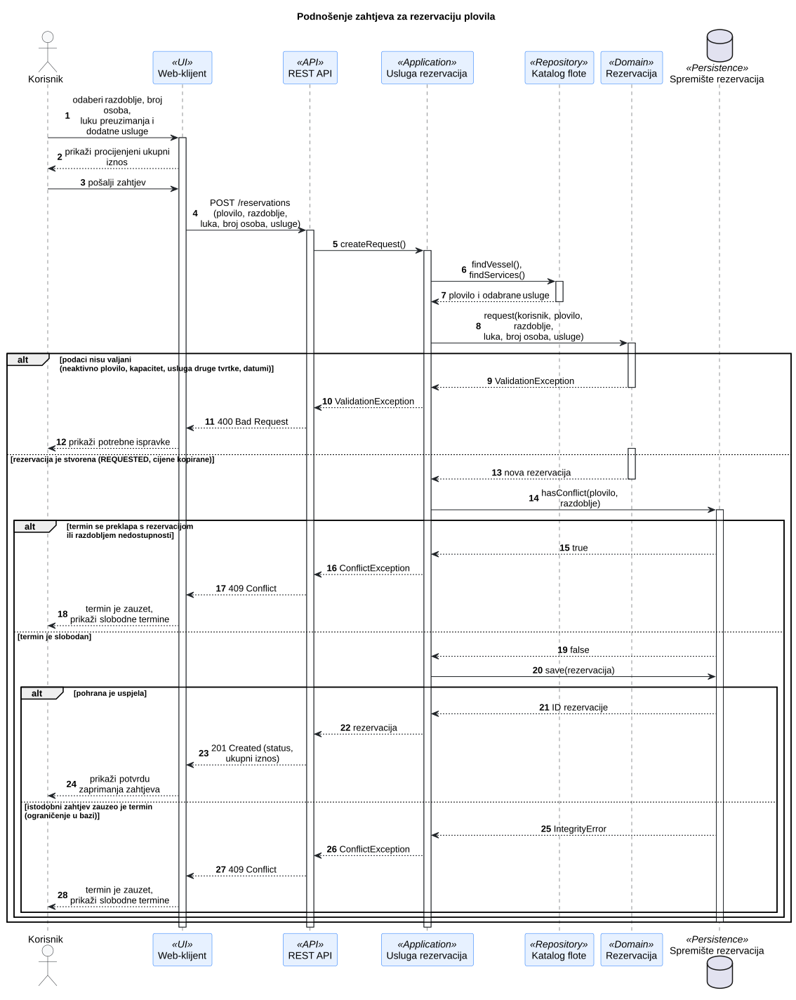
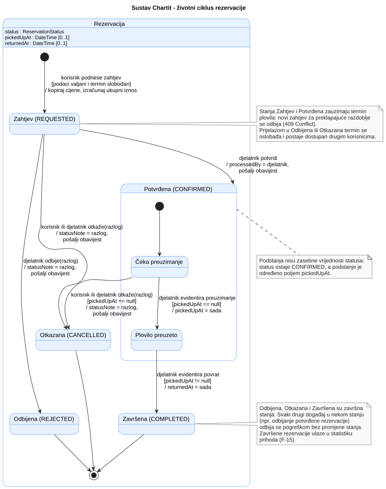
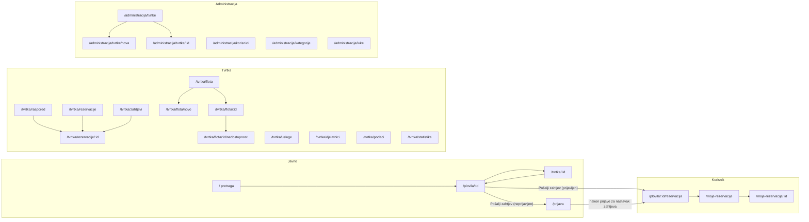

# 4. Arhitektura i oblikovanje
## 4.1 Ključne arhitekturne odluke

| Odluka | Razmatrana alternativa | Projektno specifično obrazloženje i kompromis |
| --- | --- | --- |
| Zasebna klijentska aplikacija (React SPA) i jedan poslužiteljski sustav (Django + DRF) organiziran kao modularni monolit s modulima prema odgovornostima | Django aplikacija s poslužiteljski generiranim predlošcima; više zasebno postavljenih usluga (mikroservisi) | Četiri sučelja s interaktivnim kalendarom, kartom i filtrima te tim podijeljen na klijentski i poslužiteljski dio idu u prilog zasebnom klijentu. Jedan poslužiteljski sustav omogućuje transakcijsku provjeru preklapanja nad jednom bazom i ostaje upravljiv za ovaj opseg. Cijena je zajednička točka kvara i potreba za usklađivanjem ugovora API-ja između timova. Vidi ADR-01. |
| Više charter tvrtki u zajedničkoj bazi uz filtriranje prema tvrtki | Zasebna shema ili baza po tvrtki	| Korisnik jednim računom pretražuje i rezervira plovila svih tvrtki, a kategorije i luke su zajedničke, što je u zajedničkoj bazi običan upit. Izolacija tvrtki zato ovisi o dosljednom filtriranju u aplikaciji i mora se provjeravati testovima. Obrazloženje je u ADR-02. |
| Relacijska pohrana podataka | Dokumentno orijentirana pohrana	| Tvrtke, plovila, usluge, rezervacije i korisnici međusobno su povezani stranim ključevima, a statistika vlasnika zahtijeva agregacije preko tih veza. Relacijska shema čini veze i ograničenja eksplicitnima i omogućuje provjeru preklapanja termina u samoj bazi, ali zahtijeva migracije pri svakoj promjeni modela. |
| Preklapanje termina sprječava se ograničenjem u bazi uz provjeru u aplikaciji | Provjera samo u aplikaciji | Dvostruka rezervacija istog plovila najteža je pogreška u poslovanju tvrtke, a više korisnika može istodobno tražiti isti termin. Baza jamči ispravnost i pri istodobnim zahtjevima, uz vezanje uz PostgreSQL i zasebnu provjeru razdoblja nedostupnosti. Obrazloženje je u ADR-03. |
| Poslovna pravila rezervacije u domenskom i servisnom sloju | Pravila u Django pogledima i serijalizatorima | Isti prijelazi stanja rezervacije pokreću se iz korisničkog dijela i panela tvrtke, pa pravila moraju postojati na jednom mjestu i biti provjerljiva testovima bez HTTP-a i baze. Kompromis je dodatni sloj koda koji odstupa od uobičajenih Django primjera, što timu bez iskustva s Djangom zahtijeva dogovor i pregled koda. |
| Cijene se kopiraju u rezervaciju pri podnošenju zahtjeva | Izračun iz trenutačnih cijena; povijest cijena s razdobljima važenja | Vlasnik slobodno mijenja cijene plovila i usluga, a korisnik i statistika prihoda moraju zadržati iznos iz trenutka rezervacije. Model ostaje jednostavan uz dupliciranje cijena u više tablica. Obrazloženje je u ADR-04. |
| Zapisi se deaktiviraju umjesto brisanja | Brisanje s kaskadnim uklanjanjem povezanih podataka	| Deaktivirana tvrtka, plovilo ili djelatnik i dalje su dio povijesti rezervacija i statistike. Kompromis je obavezno filtriranje aktivnih zapisa u pretrazi i panelima te rast baze s neaktivnim podacima. |
| Vanjski servisi uz postupnu degradaciju, a prognoza putem poslužitelja | Izravni pozivi iz preglednika bez obrade nedostupnosti | Prognoza i karta dopunjuju detalje plovila, ali njihova nedostupnost ne smije spriječiti pretragu i rezervaciju. Poslužitelj skriva ključ i privremeno pohranjuje prognozu, uz dodatnu komponentu i moguće kašnjenje podataka. Obrazloženje je u ADR-05.

## 4.2 Gradivni blokovi i UML dijagram komponenata

**Dijagram komponenata:**

**Slika 4.1. Dijagram komponenata sustava ChartIt**

**PlantUML izvor:** [izvor](./puml/4-1-chartit-system-CMP.puml)
| Komponenta | Odgovornost | Razlog za ovu granicu |
| --- | --- | --- |
| Web klijent | Krovna komponenta za interakciju s korisnikom aplikacije bez poslovne logike F-16, NF-03 | Korisnička interakcija odvojena je od poslovnih pravila najma i trajne pohrane. |
| Panel tvrtke (djelatnik, vlasnik)| Služi pregledu flote, rezervacija, preuzimanja, djelatnika i statistike. F-17, F-18| Poslovanje pojedine tvrtke odvojeno je od korisničkog i administratorskog sučelja platforme. |
| Korisnički dio (rezervacije korisnika) | Pregled plovila, zahtjevanje, otkazivanje i pregled rezervacija. | Radnje korisnika nad vlastitim rezervacijama odvojene su od upravljanja ponudom tvrtke. |
| Javni dio (pretraga i detalji plovila)| Pregled plovila, detalji i pregled slobodnih tremina | Sadržaj dostupan bez prijave odvojen je od funkcionalnosti koje zahtijevaju autentifikaciju. |
| Administracija platforme | Pregled i editiranje tvrtki, vlasnika, kategorija i luka | Upravljanje platformom kao cjelinom odvojeno je od poslovanja pojedinih tvrtki. |
| REST API | Prima zahtjeve od web-klijenta i odgovara na njih. | Odgovornosti izložene putem HTTP-a odvojene su od poslovne logike pojedinih domena. |
| Usluga vremenske prognoze | Komunicira s vanjskom uslugom za vremenske prognoze. F-15, NF-06| Komunikacija s vanjskim API-jem za prognozu odvojena je od ostatka sustava, uz mogućnost privremene pohrane i obrade nedostupnosti. |
| Upravljanje tvrtkama | Komponenta preko koje se upravlja tvrtkama i djelatnicima (stvaranje, editiranje, brisanje). F-25, F-26, F-27, F-28| Podaci o tvrtkama i njihovim djelatnicima odvojeni su od ponude plovila koju tvrtke nude. |
| Statistika i izvještaj | Komponenta preko koje se računa, prikazuje i izvozi statistika. F-13, F-14, F-31, NF-07| Agregacija i izvoz podataka odvojeni su od operativne obrade rezervacija. |
| Autentifikacija i korisnici | Komponenta koja je u komunikaciji s OAuth poslužiteljem. Prijava i stvaranje korisnika. | Identitet i uloge korisnika odvojeni su od komunikacije s vanjskim OAuth pružateljem i od poslovnih podataka. |
| Usluga rezervacija | Komponenta za stvaranje zahtjeva za rezervacije. Također vraća informacije o rezervacijama. F-02, F-03, F-04, F-05, F-08, F-11, F-12, F-19, F-21, F-22 | Pravila zauzetosti, izračuna cijene i promjena statusa rezervacije odvojena su od održavanja ponude. |
| Kontrola pristupa  | Kompnenta za provjeru uloge i pripadnosti tvrtki. F-18, NF-02, NF-10| Provjera uloga i pripadnosti tvrtki izdvojena je kako bi se jednako primjenjivala na sve zahtjeve. |
| Upravljanje flotom | Plovila, cijene usluga, fotografije, razdoblja zauzetosti. F-01, F-07, F-09, F-20, F-23, F-29, F-30| Ponuda plovila, cijena, dodatnih usluga i razdoblja nedostupnosti odvojena je od procesa rezerviranja. |
| Usluga obavjesti | Komunikacija s vanjskim servisom za slanje elektroničke pošte. F-06, F-24| Slanje e-pošte odvojeno je od obrade rezervacija kako zastoj vanjskog poslužitelja ne bi utjecao na rezervaciju. |


## 4.3 Model podataka i oblikovanje razreda

### 4.3.1 ER dijagram i model podataka

<br>
**Slika 4.2. ER dijagram podataka sustava ChartIt**

**PlantUML izvor:** [izvor](./puml/4-2-chartit-data-ERD.puml)

**Napomene za dijagram:**
1. Jedna tablica Korisnik pokriva sve uloge. Djelatnik i vlasnik pripadaju točno jednoj
tvrtki, a korisnik i administrator nemaju tvrtku (company_id je prazan).
Svaka tvrtka ima najviše jednog aktivnog vlasnika (jedinstveno ograničenje).
2. Tvrtka rezervacije određena je plovilom pa se ne pohranjuje zasebno.
Dnevna cijena i ukupni iznos pohranjuju se u trenutku podnošenja zahtjeva
kako kasnije promjene cijena ne bi mijenjale postojeće rezervacije.
Termini istog plovila ne smiju se preklapati (ograničenje u bazi).
3. Katalog dodatnih usluga definira se na razini tvrtke i vrijedi za sva njezina plovila; cijena je fiksna po najmu.

### 4.3.2 Reprezentativni UML dijagram razreda

<br>
**Slika 4.3. Dijagram razreda za obradu rezervacija**

**PlantUML izvor:** [izvor](./puml/4-3-chartit-domain-CD.puml)

## 4.4 Ponašanje tijekom izvođenja

### 4.4.1 Reprezentativni UML sekvencijski dijagram
<br>
**Slika 4.4 Sekvencijski dijagram podnošenja zahtjeva za rezervaciju**

**PlantUML izvor:** [izvor](./puml/4-4-chartit-reservation-request-SD.puml)

### 4.4.2 Reprezentativni UML dijagram stanja
<br>
**Slika 4.5 Dijagram stanja za podnošenje zahtjeva za rezervaciju**

**PlantUML izvor:** [izvor](./puml/4-5-chartit-reservation-SM.puml)

## 4.5 Zapisi arhitekturnih odluka

### ADR-01: Jedan poslužiteljski sustav (Django) i zasebna React aplikacija
| Polje | Zapis odluke |
| --- | --- |
| Kontekst i cilj | Tim od sedam članova tijekom jednog semestra mora izraditi i javno postaviti platformu za najam plovila više charter tvrtki, s javnim dijelom, korisničkim dijelom, panelom tvrtke i administracijom. Polovica tima radi na poslužitelju, a polovica na klijentu. |
| Kriteriji odluke | Tim može izraditi, integrirati, postaviti i objasniti rješenje; poslužiteljski i klijentski dio mogu se razvijati usporedno; komponente zadržavaju prepoznatljive odgovornosti; sučelje je prilagodljivo različitim uređajima (NF-03). |
| Razmatrane alternative | Jedan Django sustav s predlošcima: jednostavno postavljanje, ali frontend tim ne može raditi neovisno, a interaktivni dijelovi (kalendar, karta, filtri) teže se izrađuju. Jedan Django sustav s REST API-jem i zasebnom React aplikacijom: jasna podjela rada uz jedno ugovoreno sučelje. Zasebne usluge (npr. rezervacije, flota, obavijesti): neovisno postavljanje, ali znatno više rada na integraciji, postavljanju i dosljednosti podataka. |
| Odluka i obrazloženje | Odabrati jedan Django sustav s REST API-jem (DRF), podijeljen na aplikacije prema odgovornostima (accounts, companies, fleet, reservations, notifications, reports, weather), i zasebnu React aplikaciju. Time timovi rade usporedno, a postavljanje ostaje jednostavno, uz prihvaćanje da kvar poslužitelja istodobno zaustavlja sve funkcionalnosti te da se API mora unaprijed dogovoriti i održavati. |
| Status | Prihvaćeno. |

### ADR-02: Višetvrtkovnost u zajedničkoj bazi uz filtriranje po tvrtki
| Polje | Zapis odluke |
| --- | --- |
| Kontekst i cilj | Platforma poslužuje više charter tvrtki. Vlasnici i djelatnici smiju vidjeti samo podatke svoje tvrtke (NF-10), a korisnici pretražuju plovila svih tvrtki (F-29) s jednim korisničkim računom. |
| Kriteriji odluke | Pouzdana izolacija podataka tvrtki; jednostavna pretraga preko svih tvrtki; složenost primjerena timu bez iskustva s Djangom; mogućnost provjere izolacije testovima izravnih poziva API-ja. |
| Razmatrane alternative | Zajednička baza i sheme, tvrtka kao strani ključ: jednostavno, pretraga preko svih tvrtki je običan upit, ali izolacija ovisi o dosljednom filtriranju u aplikaciji. Zasebna PostgreSQL shema po tvrtki (npr. django-tenants): jača izolacija, ali pretraga preko svih tvrtki i zajednički korisnici postaju složeni. Zasebna baza po tvrtki: najjača izolacija, ali neprimjereno za postavljanje i zajedničke šifrarnike. |
| Odluka i obrazloženje | Odabrati zajedničku bazu u kojoj plovila, usluge i djelatnici pripadaju tvrtki putem stranog ključa. Izolacija se provodi u komponenti Kontrola pristupa: svi upiti tvrtke filtriraju se prema tvrtki prijavljenog korisnika, a ne prema identifikatoru iz zahtjeva. Prihvaća se rizik da propušteno filtriranje otkrije tuđe podatke, što se ublažava zajedničkim baznim razredima za poglede i automatiziranim testovima s identifikatorima druge tvrtke. |
| Status | Prihvaćeno. |

### ADR-03: Sprječavanje preklapanja rezervacija ograničenjem u bazi podataka
| Polje | Zapis odluke |
| --- | --- |
| Kontekst i cilj | Isto plovilo ne smije imati preklapajuće rezervacije, a preklapanje se mora spriječiti već pri podnošenju zahtjeva (F-03). Sustav istodobno koristi više korisnika (NF-01), pa dva zahtjeva za isti termin mogu stići u istom trenutku. |
| Kriteriji odluke | Preklapanje mora biti spriječeno i pri istodobnim zahtjevima; korisnik dobiva razumljiv odgovor; rješenje je provjerljivo testovima i ne usporava znatno sustav (NF-05). |
| Razmatrane alternative | Samo provjera u aplikaciji prije spremanja: jednostavno, ali dva istodobna zahtjeva mogu proći provjeru i oba se spremiti. Zaključavanje retka plovila (select_for_update) tijekom provjere: sprječava utrku, ali ovisi o tome da svaki dio koda koji stvara rezervacije zaključava ispravno. Ograničenje isključivanja u PostgreSQL-u (rasponi datuma po plovilu) uz provjeru u aplikaciji: baza jamči ispravnost neovisno o kodu, a aplikacijska provjera daje korisniku jasnu poruku. |
| Odluka i obrazloženje | Odabrati ograničenje isključivanja nad razdobljem rezervacije za statuse Zahtjev i Potvrđena, uz prethodnu provjeru preklapanja u istoj transakciji, koja uključuje i razdoblja nedostupnosti. Povreda ograničenja pretvara se u odgovor 409 Conflict, jednako kao uobičajeno preklapanje. Prihvaća se vezanje uz PostgreSQL (proširenje btree_gist) te to što ograničenje ne pokriva razdoblja nedostupnosti, koja se provjeravaju samo u aplikaciji. |
| Status | Prihvaćeno. |

### ADR-04: Pohrana cijena u rezervaciji u trenutku podnošenja zahtjeva
| Polje | Zapis odluke |
| --- | --- |
| Kontekst i cilj | Vlasnik može mijenjati dnevnu cijenu plovila i cijene dodatnih usluga (F-07), a korisnik mora vidjeti iznos koji je prihvatio (F-05), dok statistika prihoda mora ostati točna za prošla razdoblja (F-13, NF-07). |
| Kriteriji odluke | Iznos postojeće rezervacije ne mijenja se nakon podnošenja; izvještaji su ponovljivi; model podataka ostaje jednostavan. |
| Razmatrane alternative | Izračun iz trenutačnih cijena putem stranog ključa: nema dupliciranja, ali promjena cijene mijenja postojeće rezervacije i prošlu statistiku. Povijest cijena s razdobljima važenja: točno, ali složeniji model i upiti. Kopiranje cijena u rezervaciju i odabrane usluge: jednostavno i ponovljivo, uz manje dupliciranja podataka. |
| Odluka i obrazloženje | Odabrati kopiranje dnevne cijene u rezervaciju i cijene svake usluge u zapis odabrane usluge pri stvaranju rezervacije te pohranu ukupnog iznosa koji izračunava poslužitelj. Iznos koji prikazuje klijent samo je procjena. Prihvaća se da se ista cijena nalazi na više mjesta i da se naknadno ispravljanje cijene ne prenosi na postojeće rezervacije. |
| Status | Prihvaćeno. |

### ADR-05: Dohvat vremenske prognoze putem poslužitelja
| Polje | Zapis odluke |
| --- | --- |
| Kontekst i cilj | Detalji plovila prikazuju vremensku prognozu za lokaciju i razdoblje najma (F-15). Vanjski servis može biti nedostupan, a korisnik tada mora dobiti obavijest (NF-06), dok stranica mora ostati brza (NF-05). |
| Kriteriji odluke | Ključ vanjskog servisa ne smije biti izložen u pregledniku; nedostupnost servisa ne smije zaustaviti prikaz detalja plovila; mogućnost zamjene pružatelja bez promjene klijenta. |
| Razmatrane alternative | Izravan poziv iz preglednika: manje koda na poslužitelju, ali ključ je izložen, nema privremene pohrane i svaki klijent ovisi o formatu vanjskog servisa. Dohvat putem poslužitelja (usluga vremenske prognoze): dodatna komponenta, ali omogućuje privremenu pohranu, jedinstven format odgovora i kontroliranu obradu pogrešaka. |
| Odluka i obrazloženje | Odabrati dohvat putem poslužitelja, uz privremenu pohranu odgovora za lokaciju i datum te zaseban zahtjev klijenta, tako da se detalji plovila prikazuju i kad prognoza nije dostupna. Kartografske pločice dohvaćaju se izravno iz preglednika jer ne zahtijevaju ključ. Prihvaća se dodatno opterećenje poslužitelja i moguće kašnjenje prognoze zbog privremene pohrane. |
| Status | Prihvaćeno. |

## 4.6 Zajednička pravila oblikovanja (engl. Cross-cutting concerns)

| Aspekt | Mehanizam | Pravilo | Mjesto primjene
| --- | --- | --- | --- |
| Sigurnost | Autentifikacija putem vanjskog OAuth pružatelja | Svi zahtjevi osim javne pretrage i detalja plovila zahtijevaju prijavljenog korisnika; identitet se utvrđuje na poslužitelju iz tokena ili sesije, nikad iz podataka koje šalje klijent. | Aplikacija accounts; zadana klasa autentifikacije u DRF postavkama; javni pogledi izričito označeni kao dostupni bez prijave. |
| Sigurnost | Autorizacija prema ulogama | Ovlasti korisnika, djelatnika, vlasnika i administratora provjeravaju se na poslužiteljskoj strani prije svake radnje; skrivanje gumba u korisničkom sučelju nije dovoljna zaštita. | DRF klase dopuštenja (npr. IsCompanyEmployee, IsCompanyOwner, IsPlatformAdmin) na svim pogledima; provjere u ReservationService. |
| Sigurnost | Izolacija podataka tvrtki | Podaci tvrtke uvijek se filtriraju prema tvrtki prijavljenog korisnika, a ne prema identifikatoru iz URL-a ili tijela zahtjeva; zahtjev za objekt druge tvrtke vraća 404 Not Found | Zajednički bazni razred pogleda koji ograničava get_queryset() na request.user.company; svi pogledi panela tvrtke; automatizirani testovi s identifikatorima druge tvrtke (NF-10). | 
| Sigurnost	| Zaštita komunikacije i tajni | Sva komunikacija ide putem HTTPS-a, veza s bazom je zaštićena, a ključevi, lozinke i tajne OAuth-a čitaju se iz varijabli okruženja i ne pohranjuju se u repozitorij. | Django postavke (SECURE_SSL_REDIRECT, DATABASES), konfiguracija postavljanja, datoteka .env izvan repozitorija (NF-04, NF-08).
| Validacija podataka | Dvorazinska validacija | Klijent provjerava unos radi boljeg korisničkog iskustva, ali je provjera na poslužitelju jedina mjerodavna: serijalizatori provjeravaju oblik podataka, a domenski razredi poslovna pravila (kapacitet, datumi, pripadnost usluga tvrtki). | React obrasci; DRF serijalizatori; Reservation.request() i RentalPeriod.
| Integritet podataka | Transakcije i ograničenja u bazi | Radnje koje mijenjaju više zapisa izvode se u jednoj transakciji; pravila koja se moraju poštovati i pri istodobnom radu provode se ograničenjima u bazi. | transaction.atomic u metodama ReservationService; ograničenje isključivanja za rezervacije, jedinstveni vlasnik po tvrtki (ADR-03).
| Integritet podataka | Upravljanje stanjem rezervacije	| Status rezervacije mijenja se isključivo metodama domenskog razreda pozvanima iz servisa; pogledi i serijalizatori ne postavljaju status izravno. | Reservation.confirm(), reject(), cancel(), recordPickup(), recordReturn(); status samo za čitanje u serijalizatorima.
| Integritet podataka | Deaktivacija umjesto brisanja | Tvrtke, plovila, usluge i korisnici se deaktiviraju, a ne brišu, kako bi povijest rezervacija i statistika ostale potpune. | Polje is_active i filtriranje aktivnih zapisa u javnoj pretrazi; strani ključevi s on_delete=PROTECT (NF-07, UC-15).
| Obrada pogrešaka | Jedinstveno preslikavanje iznimki u HTTP odgovore | Domenske iznimke preslikavaju se na jednom mjestu u odgovarajuće statuse (400, 401, 403, 404, 409, 500) i jedinstveni JSON oblik s kodom, porukom i pogreškama po poljima; korisniku se ne prikazuju tehnički detalji. | Prilagođeni DRF exception handler; zajednički modul klijenta za obradu odgovora i prikaz poruka.
| Integracija vanjskih servisa | Ograničeno čekanje i postupna degradacija | Pozivi vremenske prognoze i kartografskih pločica imaju vremensko ograničenje; nedostupnost servisa prikazuje se kao obavijest, a ostatak stranice radi normalno. | weather aplikacija (timeout, privremena pohrana); komponente karte i prognoze u Reactu (NF-06, ADR-05).
| Obavijesti | Slanje nakon potvrde transakcije	| E-pošta se šalje tek nakon uspješne pohrane promjene; neuspjeh slanja se bilježi, ali ne poništava rezervaciju. | transaction.on_commit u ReservationService; implementacija sučelja ReservationNotifier.
| Upravljanje ovisnostima | Injektiranje ovisnosti | Servis koji provodi poslovnu logiku ne stvara sam konkretne implementacije pohrane i slanja e-pošte, nego ih prima izvana, pa se u testovima mogu zamijeniti | ReservationService prima implementacije sučelja ReservationRepository, FleetCatalog i ReservationNotifier.
| Novčani iznosi | Decimalni zapis cijena | Cijene i iznosi pohranjuju se i računaju kao decimalni brojevi s dvije decimale u eurima, nikad kao brojevi s pomičnim zarezom; ukupni iznos računa poslužitelj. | DecimalField u modelima; Reservation.totalPrice(); serijalizatori vraćaju iznose kao tekst (ADR-04).
| Datumi i vrijeme | Jedinstvena pravila vremenskih zona | Razdoblje najma pohranjuje se kao datumi bez vremena, a trenuci događaja (podnošenje, preuzimanje, povrat) kao vrijeme u UTC-u; prikaz korisniku je u vremenskoj zoni Europe/Zagreb. | USE_TZ = True; RentalPeriod; formatiranje datuma u zajedničkom modulu klijenta.
| Odzivnost	| Indikatori učitavanja i straničenje | Svaki zahtjev prema poslužitelju prikazuje indikator učitavanja, a popisi (pretraga, rezervacije, plovila) dohvaćaju se po stranicama. | Zajednički React hook za dohvat podataka; DRF zadano straničenje (NF-05).

## 4.7 Arhitekturni rizici i tehnički dug

**Tehnički rizici i dug**

| Rizik ili kompromis | Posljedica | Odgovor na rizik |
| --- | --- | --- |
| Jedna instanca poslužiteljske aplikacije i jedna baza podataka (ADR-01). | Kvar smještaja aplikacije ili baze privremeno onemogućuje pretragu, rezervacije i rad tvrtki. | Rizik je prihvaćen za opseg projekta; ne uvodi se pričuvna instanca ni automatsko prebacivanje. Baza se može sigurnosno kopirati. |
| Izolacija podataka tvrtki ovisi o filtriranju u aplikaciji, a ne o razdvajanju u bazi (ADR-02). | Pogled u kojem je filtriranje izostavljeno mogao bi otkriti ili omogućiti izmjenu podataka druge tvrtke. | Svi pogledi panela tvrtke nasljeđuju zajednički bazni razred koji ograničava upite na tvrtku korisnika; automatizirani testovi izravno pozivaju API s identifikatorima druge tvrtke (NF-10); pregled koda pri svakom spajanju. |
| Ograničenje u bazi sprječava preklapanje samo među rezervacijama, ne i s razdobljima nedostupnosti (ADR-03). | Vlasnik koji unosi nedostupnost i korisnik koji istodobno šalje zahtjev mogli bi stvoriti preklapanje. | Unos nedostupnosti i stvaranje rezervacije zaključavaju redak plovila (select_for_update) i provjeravaju preklapanje u istoj transakciji; vjerojatnost je mala, pa se dodatno ograničenje u bazi ne uvodi. |
| Oslanjanje na mogućnosti specifične za PostgreSQL (rasponi datuma, proširenje btree_gist). | Rješenje se ne može izvoditi na SQLite-u, a razlika okruženja može sakriti pogreške. | Svi članovi tima i testovi koriste PostgreSQL u Dockeru; SQLite se ne koristi ni lokalno. |
| Fotografije plovila pohranjuju se u datotečni sustav poslužitelja. | Pri ponovnom postavljanju ili zamjeni kontejnera fotografije se mogu izgubiti. | Mapa za medije montira se kao trajni volumen; prijelaz na S3 kompatibilnu pohranu ostavljen je kao mogući sljedeći korak. |
| E-pošta se šalje iz poslužiteljske aplikacije bez zasebnog pozadinskog procesa i ponovnih pokušaja. | Sporiji odgovor pri potvrdi ili odbijanju zahtjeva; obavijest se gubi ako poslužitelj e-pošte nije dostupan. | Prihvaćeni tehnički dug. Slanje se izvodi nakon potvrde transakcije, neuspjeh se bilježi u dnevnik, a status rezervacije uvijek je vidljiv u aplikaciji, pa obavijest nije jedini izvor informacije. |
| Ugovor API-ja između poslužiteljskog i klijentskog tima može se razići tijekom usporednog razvoja. | Klijent šalje ili očekuje podatke drugačijeg oblika, a pogreške se otkrivaju tek pri integraciji. | Shema API-ja generira se iz koda (OpenAPI, npr. drf-spectacular) i služi kao zajednička dokumentacija; promjene sučelja najavljuju se u zahtjevu za spajanje. |
| Tim nema iskustva s Djangom i DRF-om. | Različiti dijelovi koda mogu slijediti različite obrasce, a poslovna pravila mogu završiti u pogledima i serijalizatorima. | Aplikacija reservations izrađuje se prva kao referentni primjer slojeva (pogled, servis, domena); pravila iz poglavlja o zajedničkim pravilima oblikovanja provjeravaju se pri pregledu koda. |
| Prijava ovisi isključivo o vanjskom OAuth pružatelju. | Testiranje različitih uloga zahtijeva više stvarnih računa, a nedostupnost pružatelja onemogućuje prijavu. | U lokalnom razvoju omogućena je prijava testnih korisnika bez OAuth-a (zastavica ENABLE_TEST_LOGIN). Na javnoj instanci je isključena, osim po potrebi za demonstraciju, i tada samo za unaprijed pripremljene demo račune zaštićene lozinkom. Nedostupnost pružatelja prihvaćena je kao rizik. |

**Poslovni ili domenski rizici**

| Rizik | Posljedica | Odgovor na rizik |
| --- | --- | --- |
| Neobrađeni zahtjevi zauzimaju termin. Zahtjev blokira datume do potvrde ili odbijanja (ADR-03). | Ako djelatnik ne obradi zahtjev, plovilo ostaje nedostupno drugim korisnicima, a tvrtka gubi moguće najmove. | Djelatnik vidi neobrađene zahtjeve poredane prema datumu početka najma. Automatsko otkazivanje zahtjeva kojima je prošao datum početka razmotrit će se u sljedećoj iteraciji. |
| Nejasno značenje zadnjeg dana najma. | Korisnik i tvrtka mogu različito tumačiti smije li novi najam početi na dan povrata, što dovodi do spornih preklapanja. | Razdoblje se tretira kao poluotvoreni interval: dan povrata može biti dan preuzimanja za sljedeći najam. Pravilo je jasno prikazano u sučelju pri odabiru datuma. |
| Deaktivacija tvrtke s budućim potvrđenim rezervacijama. | Plovila nestaju iz pretrage, a korisnici imaju rezervacije kod tvrtke koja više nije aktivna. | Rezervacije ostaju vidljive korisnicima s kontaktom tvrtke; administrator prije deaktivacije vidi broj budućih rezervacija. Rješavanje tih najmova odgovornost je tvrtke izvan sustava. |
| Vremenska prognoza može se shvatiti kao jamstvo. | Korisnik planira najam za nekoliko mjeseci na temelju prognoze koja je pouzdana samo nekoliko dana unaprijed. | Prognoza se prikazuje samo za dane unutar raspona pružatelja, uz oznaku da je informativna; za dalje datume prikazuje se poruka da prognoza još nije dostupna. |
| Procijenjeni iznos u pregledniku razlikuje se od konačnog. | Korisnik može očekivati iznos koji nije zapisan u rezervaciji, npr. ako je vlasnik u međuvremenu promijenio cijenu. | Mjerodavan je iznos koji izračuna poslužitelj (ADR-04); prikazuje se u potvrdi zahtjeva i detaljima rezervacije. | 
## 4.8 Mapa stranica i ruta klijentske aplikacije

> Radna inačica za zadatak #52, prije pregleda s timom. Rute su ulaz za kostur React aplikacije (#61) i wireframee (#53 do #57).

Za sve ekrane iz ove mape zajednički nacrti i pravila učitavanja, praznih stanja, grešaka, obavijesti i potvrdnih dijaloga definirani su u [katalogu zajedničkih stanja sučelja (#58)](dizajn/58-Zajednicka-stanja-sucelja.md). [Tablica primjene po ekranima](dizajn/58-Zajednicka-stanja-sucelja.md#primjena-po-ekranima) povezuje rute s oznakama uzoraka koje se koriste u wireframeima #53–#57.

[Skice rezervacija i prijave (#54)](dizajn/54-Wireframe-korisnickog-dijela.svg) prate korisnički tok od odabira termina do pregleda i otkazivanja rezervacije. Dostupan je i [izvor za uređivanje u Excalidrawu](dizajn/54-Wireframe-korisnickog-dijela.excalidraw).

**Dogovor o URL-ovima:** rute klijentske aplikacije pišu se na hrvatskom, malim slovima, bez dijakritičkih znakova i s crticom između riječi (npr. `/moje-rezervacije`). Prefiksi `/api`, `/admin` i `/static` pripadaju Djangu, pa se administracija platforme u klijentu nalazi pod `/administracija`. Sve ostale putanje Django vraća kao React aplikaciju, koja ih sama usmjerava.

Uloge odgovaraju polju `role` korisnika (KORISNIK, DJELATNIK, VLASNIK, ADMINISTRATOR); posjetitelj je neprijavljeni korisnik.

### Javni dio (bez prijave)

| Ekran | Ruta | Pristup | UC | F | Sadržaj |
| --- | --- | --- | --- | --- | --- |
| Početna i pretraga | `/` | svi | UC-01 | F-01, F-23, F-29 | Filtri (termin, luka polaska, kategorija, broj osoba, tvrtka), kartice rezultata, straničenje, poruka kada nema rezultata. |
| Detalji plovila | `/plovila/:id` | svi | UC-11 | F-15, F-16, F-20 | Galerija, karakteristike i oprema, tvrtka s kontaktom, dnevna cijena, kalendar slobodnih termina, karta matične luke, prognoza, dodatne usluge, procjena cijene, gumb „Pošalji zahtjev”. |
| Podaci o tvrtki | `/tvrtke/:id` | svi | UC-01 | F-29 | Osnovni podaci i kontakt tvrtke te popis njezinih plovila. |
| Prijava | `/prijava` | neprijavljeni | UC-10 | F-18 | Gumb za prijavu preko OAuth pružatelja, poruka o neuspjeloj prijavi; u razvoju i prijava testnih korisnika (ENABLE_TEST_LOGIN). |

[Skice javnog dijela (#53)](dizajn/53-Wireframe-javnog-dijela.svg) prikazuju pretragu s filtrima i rezultatima, stanje bez rezultata, detalje plovila, stanja kalendara, prognoze i karte te podatke o tvrtki. Dostupan je i [izvor za uređivanje u Excalidrawu](dizajn/53-Wireframe-javnog-dijela.excalidraw). Oznake zahtjeva na skicama slijede trenutačnu numeraciju iz [poglavlja 2](2-Analiza-zahtjeva.md): pretraga F-01, detalji plovila F-02, prognoza F-16, karta F-17.

### Korisnički dio

| Ekran | Ruta | Pristup | UC | F | Sadržaj |
| --- | --- | --- | --- | --- | --- |
| Zahtjev za rezervaciju | `/plovila/:id/rezervacija` | KORISNIK | UC-02 | F-02, F-03, F-04 | Odabir razdoblja i dodatnih usluga, prikaz luke preuzimanja (matične luke plovila), unos broja putnika, sažetak s procjenom i slanje. Potvrda prikazuje pohranjeni iznos koji je izračunao poslužitelj. Potvrda i greška preklapanja prikazuju se kao stanja ovog ekrana. |
| Moje rezervacije | `/moje-rezervacije` | KORISNIK | UC-03 | F-05, F-06 | Popis rezervacija sa statusom, terminom i iznosom; filtriranje prema statusu; straničenje. |
| Detalji rezervacije | `/moje-rezervacije/:id` | KORISNIK | UC-03 | F-05, F-06, F-12 | Svi podaci, pohranjeni iznos, odabrane usluge, kontakt tvrtke, otkazivanje s potvrdnim dijalogom. |

### Panel tvrtke

Skice panela za [#55](https://github.com/tmpteamname1/ChartIt/issues/55) dostupne su kao [SVG pregled](dizajn/55-Wireframe-panela-tvrtke.svg) i [uređivi Excalidraw](dizajn/55-Wireframe-panela-tvrtke.excalidraw).

| Ekran | Ruta | Pristup | UC | F | Sadržaj |
| --- | --- | --- | --- | --- | --- |
| Zahtjevi za rezervaciju | `/tvrtka/zahtjevi` | DJELATNIK, VLASNIK | UC-12 | F-04, F-05, F-07, F-11 | Zahtjevi poredani prema datumu početka najma, potvrda i odbijanje. Početni ekran panela. |
| Raspored preuzimanja i povrata | `/tvrtka/raspored` | DJELATNIK, VLASNIK | UC-06 | F-13 | Preuzimanja i povrati po danima ili tjednu, odabir razdoblja. |
| Rezervacije tvrtke | `/tvrtka/rezervacije` | DJELATNIK, VLASNIK | UC-05 | F-04, F-05, F-07, F-11 | Filtri prema statusu, plovilu i razdoblju. Dodavanje, izmjena i otkazivanje otvaraju dijaloge na popisu. Obrazac traži korisnika po točnoj adresi e-pošte i prikazuje dodatne usluge te ukupan iznos koji računa poslužitelj. Za spremanje rezervacije mora biti odabran registrirani korisnik. |
| Detalji rezervacije (panel) | `/tvrtka/rezervacije/:id` | DJELATNIK, VLASNIK | UC-05, UC-13 | F-05, F-11, F-13, F-14 | Podaci o plovilu i korisniku, odabrane usluge i pohranjeni iznos, evidentiranje preuzimanja i povrata te završetak najma. |
| Flota | `/tvrtka/flota` | VLASNIK | UC-04 | F-08, F-09 | Popis plovila tvrtke, deaktivacija. |
| Novo plovilo | `/tvrtka/flota/novo` | VLASNIK | UC-04 | F-08, F-09 | Obrazac plovila s osnovnim podacima, kategorijom, lukom, kapacitetom, opremom, fotografijama i cijenom. |
| Izmjena plovila | `/tvrtka/flota/:id` | VLASNIK | UC-04 | F-08, F-09 | Isti obrazac s postojećim podacima. |
| Nedostupnost plovila | `/tvrtka/flota/:id/nedostupnost` | VLASNIK | UC-09 | F-04, F-10 | Razdoblja nedostupnosti, upozorenje o preklapanju s rezervacijom. |
| Dodatne usluge | `/tvrtka/usluge` | VLASNIK | UC-04 | F-09 | Katalog usluga tvrtke s cijenama (vrijede za sva plovila tvrtke). |
| Djelatnici | `/tvrtka/djelatnici` | VLASNIK | UC-08 | F-21 | Popis djelatnika s dijalozima za dodavanje, izmjenu i deaktivaciju. |
| Podaci o tvrtki | `/tvrtka/podaci` | VLASNIK | – | F-20 | Obrazac s podacima tvrtke. OIB je u ovom obrascu samo za čitanje. |
| Statistika | `/tvrtka/statistika` | VLASNIK | UC-07 | F-15 | Odabir razdoblja, zauzetost, rezervacije, prihod, popularnost usluga i kategorija, izvoz u CSV. |

Ruta `/tvrtka` preusmjerava na `/tvrtka/zahtjevi`.

Oznake F u tablici slijede [analizu zahtjeva](2-Analiza-zahtjeva.md#21-funkcijski-zahtjevi). Prema F-11 i [UC-05](3-Obrasci-uporabe.md#uc-05-upravljanje-rezervacijama), djelatnik i vlasnik upravljaju rezervacijama vlastite tvrtke. Usklađivanje React routera i izbornika ide u zaseban zadatak.

### Administracija platforme

| Ekran | Ruta | Pristup | UC | F | Sadržaj |
| --- | --- | --- | --- | --- | --- |
| Tvrtke | `/administracija/tvrtke` | ADMINISTRATOR | UC-14, UC-15 | F-19 | Popis tvrtki s pretragom i statusom. |
| Nova tvrtka | `/administracija/tvrtke/nova` | ADMINISTRATOR | UC-14 | F-19 | Obrazac tvrtke (naziv, OIB, adresa, kontakt) i dodjela vlasnika; poruka o duplikatu OIB-a. |
| Izmjena tvrtke | `/administracija/tvrtke/:id` | ADMINISTRATOR | UC-14, UC-15 | F-19 | Izmjena podataka, promjena vlasnika, deaktivacija s brojem budućih potvrđenih rezervacija. |
| Korisnici | `/administracija/korisnici` | ADMINISTRATOR | – | F-22 | Pretraga korisnika, promjena uloge, deaktivacija računa. |
| Kategorije plovila | `/administracija/kategorije` | ADMINISTRATOR | – | F-23 | Popis, dodavanje, izmjena i deaktivacija kategorija. |
| Luke | `/administracija/luke` | ADMINISTRATOR | – | F-23 | Popis, dodavanje, izmjena i deaktivacija luka, s lokacijom na karti (F-17). |

Ruta `/administracija` preusmjerava na `/administracija/tvrtke`.

[Skice administracije (#56)](dizajn/56-Wireframe-administracije.svg) prikazuju popis tvrtki, obrazac tvrtke s duplikatom OIB-a, dodjelu vlasnika, deaktivaciju i ponovnu aktivaciju tvrtke, korisnike i uloge te šifrarnike kategorija i luka s potvrdom deaktivacije. Dostupan je i [izvor za uređivanje u Excalidrawu](dizajn/56-Wireframe-administracije.excalidraw). Oznake F u tablici administracije i na skicama #56 slijede [analizu zahtjeva](2-Analiza-zahtjeva.md#21-funkcijski-zahtjevi).

### Sustavne stranice

| Ekran | Ruta | Sadržaj |
| --- | --- | --- |
| Nemate pristup | na adresi zaštićene rute | Prikazuje se prijavljenom korisniku bez potrebne uloge, bez promjene adrese. Neprijavljeni korisnik se preusmjerava na `/prijava`. |
| Stranica ne postoji | svaka nepoznata ruta | Poruka i poveznica na početnu stranicu. |

### Pokrivenost funkcijskih zahtjeva

Svi funkcijski zahtjevi s korisničkim sučeljem pokriveni su barem jednim ekranom. Bez vlastitog ekrana su F-06 i F-24 (e-pošta; na ekranima se prikazuje samo poruka da će obavijest stići), F-18 (ostvaruje se izbornikom i zaštitom ruta prema ulozi) te F-19 (oslobađanje termina posljedica je otkazivanja na ekranu detalja rezervacije).

### Glavni izbornik prema ulozi

| Uloga | Zaglavlje | Bočni izbornik |
| --- | --- | --- |
| Posjetitelj | Logo (početna), Pretraga, Prijava | – |
| KORISNIK | Logo, Pretraga, Moje rezervacije, izbornik računa (Odjava) | – |
| DJELATNIK | Logo, Pretraga, Panel tvrtke, izbornik računa | Zahtjevi, Raspored, Rezervacije |
| VLASNIK | Logo, Pretraga, Panel tvrtke, izbornik računa | Zahtjevi, Raspored, Rezervacije, Flota, Dodatne usluge, Djelatnici, Podaci o tvrtki, Statistika |
| ADMINISTRATOR | Logo, Pretraga, Administracija, izbornik računa | Tvrtke, Korisnici, Kategorije, Luke |

Na mobitelu se poveznice iz zaglavlja i bočni izbornik sklapaju u izbornik koji se otvara gumbom (hamburger).

### Dijagram navigacije



### Mobilni prikaz (#57)

Skice razrađuju mobilni prikaz prema [NF-03](2-Analiza-zahtjeva.md#22-nefunkcijski-zahtjevi). Širina je 375 px, uz varijantu odabira termina na 320 px. Oznake ispod skica povezuju ih s rutama, ulogama i zahtjevima.

- [Pregled svih skica (SVG)](dizajn/57-Wireframe-mobilnog-prikaza.svg)
- [Uređivi izvor (Excalidraw)](dizajn/57-Wireframe-mobilnog-prikaza.excalidraw)

Nakon izmjene izvorne datoteke u Excalidrawu izvezite cijelu scenu preko **Export image → SVG** s uključenom pozadinom i zamijenite SVG pregled.

**Pregled skica**

| Skice | Što prikazuju |
| --- | --- |
| 01, 02, 01b | Rezultati, otvoreni filtri i pretraga bez rezultata. |
| 03a–03c | Jedna stranica detalja plovila pri pomicanju. Ispod galerije slijede kalendar, karta, prognoza, dodatne usluge i procjena iznosa. |
| 03b-320 | Okomiti popis dostupnosti s odabirom datuma preuzimanja i povrata na zaslonu od 320 px. |
| 04a–04d | Prijava za nastavak, zahtjev s lukom i brojem putnika, zauzeti termin uz očuvane usluge i potvrda slanja. |
| 05, 06, 06b, 06c | Moje rezervacije, detalji s kontaktom tvrtke, potvrda otkazivanja i prikaz nakon preuzimanja. |
| 07, 07b, 08, 09, 09b | Tjedni raspored, prazno razdoblje, evidentiranje preuzimanja i povrata te završeni najam. |
| N1–N5 | Otvoreni izbornik za posjetitelja, korisnika, djelatnika, vlasnika i administratora. |

**Prijelomne točke**

Prijelomi slijede Mantineove točke `sm` i `md`. Širine u pikselima vrijede pri zadanoj veličini fonta preglednika od 16 px.

| Širina prikaza | Raspored |
| --- | --- |
| Mobitel, ispod `48em` (< 768 px) | Jedan stupac. Glavna navigacija otvara se gumbom u zaglavlju. Filtri pretrage otvaraju zaseban prikaz preko rezultata. |
| Tablet, od `48em` do ispod `62em` (768–991 px) | Vraćaju se poveznice u zaglavlju i bočni izbornik u panelima. Kartice i kratka polja mogu u dva stupca gdje ima dovoljno prostora. |
| Računalo, od `62em` (≥ 992 px) | Koristi se širi raspored prema skicama javnog dijela, korisničkog dijela i panela. |

**Pravila za manje zaslone**

- **Tablice.** Popisi s radnjama po zapisu, primjerice zahtjevi, rezervacije, flota i tvrtke, na mobitelu prelaze u kartice. Na kartici ostaju naziv ili identifikator, ključni podaci, status i radnja za taj zapis. Guste tablice za usporedbu, primjerice u statistici, mogu se pomicati vodoravno unutar vlastitog okvira uz vidljiva zaglavlja. Stranica se pomiče okomito.
- **Obrasci i dijalozi.** Polja, oznake i poruke greške slažu se u jedan stupac. Gumbi se nižu ispod sadržaja, s dodirnim područjem od najmanje 44 × 44 px. Pri prikazu tipkovnice obrazac se može pomicati do aktivnog polja i njegove greške. U potvrdnom dijalogu fokus prvo ide na odustajanje, a pri zatvaranju bez radnje vraća se na gumb koji ga je otvorio. Pri slanju se radnja privremeno onemogući prema uzorku U-03.
- **Kalendar.** Pri sadržajnoj širini od najmanje 308 px koristi se mjesečna mreža sa sedam dodirnih područja od najmanje 44 × 44 px u retku. Ispod 308 px dostupnost se prikazuje kao okomiti popis datuma s tekstualnom oznakom statusa i odvojenim poljima za datum preuzimanja i povrata. Na zaslonu od 320 px s rubovima od 16 px ostaje 288 px sadržajne širine, kao u skici 03b-320.
- **Izbornik.** Gumb u zaglavlju otvara i zatvara izbornik. U popisu je označena trenutačna stranica, a odabir poveznice zatvara izbornik. Ako popis ne stane po visini, može se pomicati do zadnje stavke. Posjetitelj ima prijavu u zaglavlju, a prijavljeni korisnik ondje otvara izbornik računa za odjavu. Skica N3 slijedi tablice ruta i izbornika u ovom odjeljku. Djelatnik i vlasnik imaju pristup rezervacijama vlastite tvrtke prema F-11 i UC-05. Usklađivanje React rute i izbornika prati [#91](https://github.com/tmpteamname1/ChartIt/issues/91).

**Ponašanje u skiciranim tokovima**

- **Pretraga.** Filtri obuhvaćaju termin, luku polaska, kategoriju, broj putnika i tvrtku. Otvaraju se s trenutačnim vrijednostima. Primjena vraća na prvu stranicu rezultata, a zatvaranje odbacuje promjene u otvorenom prikazu. Povratak iz detalja plovila zadržava primijenjene filtre i stranicu rezultata.
- **Detalji i zahtjev.** Prijedlog je da se pri nastavku iz detalja plovila odabrani datumi i identifikatori dodatnih usluga privremeno spreme u `sessionStorage` pod ključem koji uključuje ID plovila. Ako je potrebna OAuth prijava, ona se izvodi u istoj kartici, a kao povratna adresa (`next`) koristi se provjerena interna ruta `/plovila/:id/rezervacija`. Obrazac pri otvaranju preuzima odabir za to plovilo i potom briše privremeni zapis. Korisnik može urediti odabir prije slanja. Zahtjev sadrži luku preuzimanja (matičnu luku plovila) i broj putnika, od jednog do kapaciteta plovila. Iznos prije slanja je procjena, a potvrda prikazuje konačni iznos koji je poslužitelj spremio uz rezervaciju prema ADR-04. Kod preklapanja korisnik mijenja termin uz ostale sačuvane podatke. [Sekvencijski dijagram zahtjeva](#441-reprezentativni-uml-sekvencijski-dijagram)
- **Moje rezervacije.** Svaki status napisan je na kartici. Za prazan popis primjenjuje se P-02, s odlaskom na pretragu ili prikazom svih statusa ako je aktivan filtar. Na detaljima se prikazuju pohranjeni iznos i kontakt tvrtke, uključujući deaktivirane tvrtke. Dijalog D-01 dostupan je dok je rezervacija zahtjev ili je potvrđena i plovilo još nije preuzeto. Skica 06c prikazuje potvrđenu rezervaciju nakon preuzimanja, kad otkazivanje više nije dostupno. [Dijagram stanja rezervacije](#442-reprezentativni-uml-dijagram-stanja)
- **Rad u marini.** Raspored grupira događaje po danu i razlikuje preuzimanje od povrata tekstom. Nakon podataka o plovilu i korisniku slijede stanje i dostupna radnja. Evidentiranje ažurira stanje nakon potvrde poslužitelja. Ako odgovor ne stigne, najprije se osvježi stanje rezervacije. Evidentirani povrat prikazuje zabilježeno vrijeme i status „Završeni najam”.

Karta označava matičnu luku i mjesto preuzimanja. Pri nedostupnosti karte ili prognoze poruka se prikazuje u pripadajućem bloku prema V-01 ili V-02. Kalendar i nastavak prema zahtjevu ostaju dostupni. [Katalog zajedničkih stanja (#58)](dizajn/58-Zajednicka-stanja-sucelja.md#primjena-po-ekranima)

**Provjera pri implementaciji**

Na 320 i 375 px provjeriti filtre, prijavu s povratkom na zahtjev i očuvanim odabirom te radnje preuzimanja i povrata. Na 320 px provjeriti odabir oba datuma uz okomiti popis kao u skici 03b-320, a na 375 px u mjesečnoj mreži kao u skici 03b. Na 767 i 768 px provjeriti zamjenu hamburgera poveznicama u zaglavlju. Na 991 i 992 px provjeriti raspored kartica i obrazaca uz otvoren bočni izbornik. Stranica na tim širinama ostaje unutar prikaza, uz vodoravno pomicanje samo u predviđenim tablicama.

### Otvorena pitanja za pregled s timom

1. Smiju li djelatnik, vlasnik i administrator rezervirati plovilo kao korisnici? Prijedlog: ne, korisnički dio dostupan je samo ulozi KORISNIK.
2. F-22 (administrator upravlja korisničkim računima i ulogama) i F-21 (vlasnik upravlja djelatnicima) se preklapaju. Prijedlog: administrator mijenja uloge i deaktivira račune, a djelatnike tvrtke dodaje vlasnik.
3. Treba li djelatniku zaseban pregled flote (F-13 „pregled osnovnih podataka o plovilu”) ili su dovoljni podaci o plovilu u detaljima rezervacije?
4. Je li zahtjev za rezervaciju zasebna stranica ili dijalog na detaljima plovila (#54)? Prijedlog: zasebna ruta, kako bi korisnik nakon prijave mogao biti vraćen izravno na nju.

## 4.9 Konvencije REST API-ja

Pravila vrijede za sve endpointe i postavljena su jednom u `REST_FRAMEWORK` postavkama (`backend/config/settings.py`, `backend/config/api.py`), tako da ih novi pogledi dobivaju bez dodatnog koda.

### Dokumentacija API-ja

Shema OpenAPI generira se iz koda (drf-spectacular) i uvijek odgovara stvarnom stanju API-ja:

- Swagger UI: `/api/docs/` (lokalno http://localhost:5173/api/docs/), javno dostupan i u produkciji jer su endpointi zaštićeni dopuštenjima, a ne skrivanjem.
- Shema: `/api/schema/` (YAML), iz koje se po potrebi mogu generirati TypeScript tipovi za klijent.

Novi pogled pojavljuje se u dokumentaciji automatski. Kratki opis dodaje se dekoratorom `@extend_schema(summary=...)`, a pogledi koji ne koriste serijalizator (npr. `APIView` s ručno složenim odgovorom) moraju opisati odgovor s `@extend_schema(responses=...)`. Test `test_schema_generates_without_warnings` ne prolazi ako se neki pogled ne može opisati.

### URL-ovi

- Svi endpointi su pod prefiksom `/api/`.
- Nazivi resursa su engleske imenice u množini, malim slovima, s crticom između riječi, jednako kao nazivi modela u kodu: `/api/vessels/`, `/api/vessels/12/`, `/api/reservation-requests/`.
- Završna kosa crta je obavezna (`/api/vessels/`). Putanja bez nje ili nepostojeća putanja pod `/api/` vraća 404 u formatu greške API-ja.
- Svaka Django aplikacija ima vlastiti `urls.py` s DRF routerom, koji se uključuje u `api_urlpatterns` u `backend/config/urls.py`.
- Rute klijentske aplikacije i dalje su na hrvatskom (poglavlje 4.8); jezik URL-ova API-ja ne vidi korisnik.

### Popisi: straničenje, filtriranje i sortiranje

Svaki endpoint popisa vraća stranicu rezultata (20 po zadanom):

```json
{
  "count": 57,
  "next": "http://localhost:5173/api/vessels/?page=2",
  "previous": null,
  "results": [ ... ]
}
```

| Parametar | Primjer | Napomena |
| --- | --- | --- |
| `page` | `?page=2` | Stranica rezultata, počinje od 1. |
| `page_size` | `?page_size=50` | Broj rezultata po stranici, najviše 100. |
| filtri polja | `?port=3&category=1` | Samo polja navedena u `filterset_fields` ili `filterset_class` pogleda (django-filter). |
| `search` | `?search=jadran` | Tekstualna pretraga po poljima iz `search_fields`. |
| `ordering` | `?ordering=-daily_price` | Sortiranje po poljima iz `ordering_fields`; `-` znači silazno. |

Queryset pogleda popisa mora imati zadani poredak (`order_by` ili `Meta.ordering`), inače straničenje nije stabilno i Django javlja upozorenje.

### Format greške

Sve greške API-ja imaju isti oblik, pa ih klijent obrađuje na jednom mjestu:

```json
{
  "detail": "Invalid input.",
  "code": "invalid",
  "errors": {
    "start_date": ["This field is required."],
    "non_field_errors": ["Termin je zauzet."]
  }
}
```

- `detail` je kratak opis za prikaz, `code` stabilan strojni kod prema kojem klijent odlučuje što prikazati, a `errors` sadrži greške po poljima samo kod validacije (inače `null`).
- Greške koje se ne odnose na jedno polje (npr. iz `validate()` serijalizatora) nalaze se pod ključem `non_field_errors`.

| Status | `code` | Značenje i reakcija klijenta |
| --- | --- | --- |
| 400 | `invalid` | Neispravni podaci; greške se prikazuju uz polja obrasca. |
| 401 | `not_authenticated` | Korisnik nije prijavljen; klijent ga upućuje na prijavu. |
| 403 | `permission_denied` | Korisnik je prijavljen, ali nema ovlast za radnju. |
| 404 | `not_found` | Objekt ne postoji ili pripada drugoj tvrtki (poglavlje 4.6). |
| 405 | `method_not_allowed` | Metoda nije podržana na tom endpointu. |
| 409 | prema domenskoj iznimci | Sukob s postojećim stanjem, npr. preklapanje termina (uvodi se s rezervacijama). |
| 500 | – | Neočekivana greška poslužitelja; odgovor ne sadrži tehničke detalje. |

DRF uz prijavu sesijom po zadanom vraća 403 i kada korisnik nije prijavljen. Razred `config.authentication.SessionAuthentication` zato vraća 401, kako bi klijent razlikovao „prijavi se” od „nemaš ovlast”.

Poruke Djanga (npr. Django admin, „već postoji”) su na hrvatskom (`LANGUAGE_CODE = 'hr'`), a DRF nema hrvatski prijevod, pa su njegove standardne poruke („This field is required.”) na engleskom. Klijent zato za opće greške prikazuje vlastitu poruku prema polju `code`, a ne `detail`. Poruke koje pišemo sami (domenska pravila) pišu se na hrvatskom.

### Datumi, vrijeme i iznosi

- Datumi su u obliku ISO 8601 `YYYY-MM-DD` (npr. početak i kraj najma).
- Trenuci događaja su ISO 8601 s vremenskom zonom, npr. `2026-11-04T14:30:00+01:00` (zona Europe/Zagreb). Klijent šalje vrijeme s oznakom zone.
- Novčani iznosi su tekst s dvije decimale u eurima, npr. `"150.00"`, nikad broj s pomičnim zarezom (ADR-04, poglavlje 4.6).

### Dodavanje novog endpointa

1. U aplikaciji napisati serijalizator i pogled (najčešće `ModelViewSet` ili `ReadOnlyModelViewSet`).
2. Postaviti dopuštenja: po zadanom je potrebna prijava, a javni pogledi izričito postavljaju `permission_classes = [AllowAny]`.
3. Za popise postaviti zadani poredak i, po potrebi, `filterset_fields`, `search_fields` i `ordering_fields`.
4. Registrirati pogled u routeru u `urls.py` aplikacije i, ako aplikacija još nije uključena, dodati je u `api_urlpatterns`.
5. Provjeriti izgled endpointa u `/api/docs/` i napisati testove (uključujući pristup bez prijave i pristup podacima druge tvrtke).
6. Promjene oblika odgovora postojećeg endpointa najaviti u opisu pull requesta (poglavlje 4.7).
